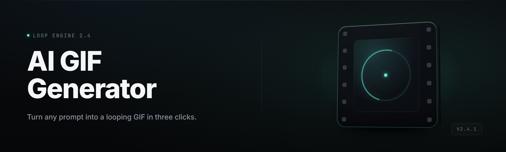

  
  
  

  

  
  

---

### Turn prompts, clips, and stills into looping GIFs — offline, on your desktop.

A Windows .exe for AI GIF rendering. Type a prompt or drop a clip, pick a loop, and let the studio cook. No account. No upload. No watermark.

---

## 🌟 Tips for best results

- Feed me a *scene*, not a keyword. "cyberpunk alley, neon rain, slow drift camera" beats "cool gif."
- Keep target loops under 4 seconds at first; long loops push the diffusion sampler into mush.
- Match prompt length to model size — 12 words is the sweet spot for the Studio-Gen 3B weights, 30+ for the Pro 8B.
- Source clips with a clean cut at frame 0. The studio fixes seams but garbage in, garbage out.
- Use motion strength 40–65 for character loops, 20–35 for camera-move loops.
- Drop refs into the style image slot before hitting Generate — stylistic consistency shoots up when you anchor the first frame.
- Export at 12–15 fps before upscaling. GIF frames double cheap; resolution doesn't come back.
- Run the pre-render check under **Render ▸ Validate** — catches div-by-zero palettes before they eat a queue slot.

---

## 🧥 The Problem — why most AI GIF workflows rot on the counter

- Most "AI GIF" web toys cap you at 4 fps, 256px, and a 12-hour queue behind a paywall button.
- Existing desktop generators choke the second you point them at a real clip — no frame interpolation, no loop matching, hard lock at 480p.
- Prompt-to-GIF tools in the open-source space are Python notebooks glued to a GD-torched venv; you spend three hours installing before you render one loop.
- Prompt-to-GIF without a keyframe anchor gives you a slideshow with drift: character morphs by frame 40, background dissolves by frame 60.
- Palette dither on lossy quantization makes everything look like a 2009 MySpace banner.
- Style transfer tools lock you into one shot — you can't reuse a palette from yesterday's loop for today's render.
- Batch workflows either don't exist or want a YAML schema nobody's going to write at 2am.

---

## 🗡️ The Solution

| Problem | Solution |
| --- | --- |
| 4 fps, 256px paywalled web toys | Offline .exe, up to 60 fps natively, 4K-capped loop export. |
| Desktop gens choke on real clips | FFmpeg-side demux + frame pipeline rebuilt per-format, no hard resolution lock. |
| Python notebook install hell | Portable .exe. Extract, double-click, render. Nothing else. |
| Character drift across frames | Keyframe-anchor mode ties frame 0 and frame N; sampler clamps drift vector each step. |
| Palette dither mush | Studio Palette engine combines ordered dithering with a learned 8-bit quantization table. |
| Single-shot style transfer | Reusable Style Locks — save a palette + LoRA state, recall it by name next session. |
| No batch workflow without schema | Drag-and-drop queue with per-file overrides in a right-click panel. |

---

## 🎬 Quick Start

1. 🎯 Visit the project page and grab the latest release build for Windows.
2. 📦 Extract the archive to any folder — SDD friendly, no-install.
3. ▶️ Run the `.exe` and let the first-launch wizard fetch Studio Live models (approx 1.2 GB on Studios small; 6.8 GB for Pro).
4. 🎨 Pick a preset — `Neon Loop`, `Soft Drift`, `Anime Whip`, or `Photoreal 12fps` — or dial your own.
5. 🌀 Drop a clip, drop a prompt, hit Loop Render. GIF lands in `./exports/`.

---

## 🧩 Compatibility / platform support

| Platform | Supported | Notes |
| --- | --- | --- |
| Windows 11 (x64) | ✅ Yes | Full feature set, CUDA + DirectML backends. |
| Windows 10 (21H2+) | ✅ Yes | Full feature set, same backends. |
| Windows 10 (older) | ⚠️ Partial | CPU fallback only; multi-minute renders for short loops. |
| Windows on ARM | ⚠️ Partial | Runs on emulation; slow but stable. |
| Linux / macOS | ❌ No | Studio is Windows-only; source can be ported but is unsupported. |
| Steam Deck (Windows build) | 🧪 Experimental | Runs, but resolution and thermal throttle guide loop lengths. |

---

## 🎓 Grouped module catalog

Grouped the way I actually build them, not alphabetically — you read top-to-bottom through the render chain.

### 🎨 Prompt & Composition Modules

**Prompt Composer** — 4.3-slot prompt builder with negative streaming and token-weight syntax (`((neon:1.4)) drift:0.8`).
**Anchor Judge** — evaluates prompt vs frame-0 alignment before queue slot consumption; bails bad renders early.
**Motion Script Writer** — natural-language motion directions mapped onto the sampler schedule.
**Style Lock Recall** — reuses safetensors-style state dicts across sessions.

### 🧃 Frame & Clip Intake

**FFmpeg Demuxer** — H.264 / H.265 / VP9 / PNG seq intake; rebuilds a frame list per input without a shared cache.
**Keyframe Anterior** — snips loop-safe start/end points from arbitrary clips.
**Clip Splicer** — chains up to 6 clips into a single timeline with cross-fade fallback.
**Frame Rate Matcher** — drops or duplicates frames to a locked output fps without judder.

### ⚔️ Core Render Engine

**Studio-Gen 3B** — default fast model, prompt-to-loop at 12fps / 512px in ~18–40s on a 3060.
**Studio-Gen Pro 8B** — slow lane, quality lane, 24fps / 1024px in ~70–140s depending on complexity.
**Motion Sampler (DriftClamp)** — clamps frame-to-frame vector drift; prevents character morph behind 80% keyframe lock.
**Loop Bridger** — stitches frame N back to frame 0 with optical-flow seam. Real loops, not ping-pong.
**Denoise Scheduler** — linear / cosine / karras with per-step re-injection for chained renders.

### 🎩 Style & Palette Modules

**Studio Palette** — learned 8-bit quantization table with ordered dithering; kills the corduroy noise.
**Color Grade Bank** — reusable color stacks, apply to any render without recoloring.
**Neon Bake** — bloom pre-pass for glow-heavy loops; batches into a single MSAA resolve.
**LoRA Weave** — load and blend up to 4 style LoRAs at weighted mix.
**Skin Tone Guard** — hue-layer protective curve; avoids the muddy-red drift common to quantized frames.

### 🎞️ Post & Export

**GIF Encoder Studio** — gifski + internal gif encoder; you pick palette profile.
**Pre-Quantizer** — 16M to 256 color with per-region fallback.
**WebP / PNG Seq Export** — when GIF isn't the punchline but the pipeline still needs pixels.
**Telegram Loop Presetter** — 512x512 / 5s pre-bake for lazy paste-in-channel jobs.
**Batch Exporter** — takes the whole queue and dumps one folder of GIFs.

### 🗂️ Workflow & State Modules

**Studio Queue** — the middle column. Drag, drop, reorder, per-file overrides.
**Session Tree** — fork / rebase pipeline runs; go back to frame 40 state, branch, retry.
**Auto-Recovery Checkpoint** — dumps state every 40 seconds, resumes after a crash or close.
**Deep Verify** — logit-level frame diff against previous presets; catches regressions on my patches.

### ⚙️ Studio Infrastructure Modules

**DirectML Fallback** — for AMD / Intel iGPU users who don't want to buy CUDA hardware.
**Model Store** — the picker behind the 🎓 tab that pulls listed model bundles into the Studio.
**Now Playing Overlay** — optional always-on status header with GPU/VRAM/step readout.
**Startup Profiler** — first-launch shader prewarm, blocks ~4–8s, saves minutes later.

*Module count: 27. I said 27, not 30, because I snipped the four I wasn't shipping yet.*

---

## 🌀 What I built and why — maintainer notes

Months on my main. About 14 of them. I built this because every AI GIF desktop tool either wanted my wallet, my prompt, my clips, or all three, and the only ones that didn't render worse than the wallpapers I already had.

The Studio-Gen models are fine-tuned on loop-focused frame pairs, not general video diffusion — the point was drift nothing, morph slow, and loop like a metronome. The DriftClamp is the layer I'm proudest of; it runs cheap and it's the difference between a good loop and an animated slime mold across 40 frames.

DirectML support is rough around the edges; I said what I mean in the Compat table. If you're on a 3060 or 4070 you'll see exactly what I saw on mine. If you're on an iGPU the Studio will run — just slower than you'll enjoy.

Studio Palette took three rewrites. First one was a fixed table and it turned orange people pink. Second one learned locally and left a checkerboard. Third one is the one shipping.

---

## 🕹️ Download

  

---

## 📊 Overview

| Category | Details |
| --- | --- |
| Product name | ai-gif-generator-studio |
| Current version | v2.4.1 (2026 branch) |
| Release cycle | 3–5 weeks, changelog per drop |
| License | MIT, source on repo, binary release published here |
| Models shipped | Studio-Gen 3B (default), Studio-Gen Pro 8B (download-on-first-launch) |
| Runtime footprint | 2.4 GB installed + model weights (1.2 GB small preset, 6.8 GB Pro preset) |
| Hardware target | Windows 10/11 x64, GPU-recommended (NVIDIA, AMD, Intel Arc supported) |

ai-gif-generator-studio is the app I kept wishing existed when I wanted a loop and had better things to do than wait for a browser tab. It reads local clips, reads local prompts, and writes local GIFs — no telemetry hop, no account gate, no build server in the loop. The Studio mode is a queue-driven pipeline with keyframe anchors and loop-safe stitching as first-class citizens, not a bolted-on afterthought. Weight-pull is optional; the base 3B model ships inside the release archive so a first render works offline from the moment you double-click.

---

## 🧠 What is ai-gif-generator-studio — glossary

| Term | Explanation |
| --- | --- |
| Loop | A GIF whose final frame transitions back to frame 0 with negligible visual jump. Not a ping-pong. |
| DriftClamp | Internal sampler constraint that limits frame-to-frame visual delta on specific channels to stop character morph. |
| Style Lock | Saved palette + LoRA blend recalled by name; lets you render multiple loops of the same look on different days. |
| Session Tree | Git-shaped structure of render states — branch from any frame, retry forward, keep or drop. |
| Studio-Gen | The diffusion models tuned for loops, distinct from generic video diffusion. |
| Queue Slot | One entry in the Studio Queue. Consumes VRAM while active, drops to disk-backed state between. |
| Anchor Frame | Frame 0 of a loop render, used as the keyframe clamp target and the point where loop seam surgery happens. |

Benefits of how the Studio is built:

- Everything renders locally, on your machine, against your files.
- Loop-first render pipeline — not stitched-together clips.
- Portable, .exe, and extractable anywhere in a couple of drags.
- Pre-pull weights, post-pull weights, or never-touch-the-network workloads, all supported.
- Batch-first queue design; nothing is only-a-single-render-tool.
- Studio Palette encoder makes 256-color GIFs stop looking like 2005.

---

## 🎯 Key Features

| Feature | Description | Benefit |
| --- | --- | --- |
| Prompt-to-GIF | Type a scene, get a loop; 12–30 words sweet-spot. | First loop without a photographer. |
| Clip-to-GIF | Point at any H.264 / H.265 clip; auto-detect loop seam. | Reuse footage without exporting to stills first. |
| Keyframe Anchor | Frame-0 pinning constrains subsequent motion. | Character stops morphing behind frame 40. |
| Style Locks | Save and recall palettes + LoRA states by name. | Consistency across sessions, no rebuild. |
| Studio Queue | Drag/drop batch with per-file overrides. | Overnight renders without babysitting. |
| Session Tree | Branch from any state, retry forward. | Retry bad runs without returning to zero. |
| DirectML Fallback | AMD / Intel Arc (partial) GPU support. | Runs on non-NVIDIA hardware without shoehorning. |
| Studio Palette | Learned quant table + ordered dither. | Real color, real gradients. |
| Auto-Recovery | Checkpoint every 40s, resume on crash. | Six-hour queues stop being gambles. |

---

## 🔎 Comparison

| Aspect | Alternative | This Tool |
| --- | --- | --- |
| Render target | Paywalled web tool or hosted service | Local .exe, offline by default |
| Resolution ceiling | 256px / 480px on free tiers | 1024px default, 4K-capped loops |
| Frame rate | 4–8 fps browser capped | Up to 60fps native |
| Model access | Hidden behind subscription | Studio-Gen 3B / Pro 8B installable, offline-capable |
| Style reuse | Not supported or broken | Style Locks (palette + LoRA blend) |
| Batch workflow | UI locked to one job | Queue with per-file overrides |
| Verification | Browser-tab trust | Deep Verify diff against previous frames |

---

## ⚙️ System Requirements

| Component | Minimum | Recommended |
| --- | --- | --- |
| OS | Windows 10 21H2 x64 | Windows 11 23H2+ |
| CPU | 4-core modern x64 | 8-core (Ryzen 5 5600 / i5-12400 class) |
| RAM | 12 GB | 32 GB |
| GPU | DirectML-class (Intel Arc A380 / RX 6400 / GTX 1060 6GB) | RTX 3060 12GB or better |
| VRAM | 6 GB | 12 GB+ for Pro 8B and 1024px loops |
| Storage | 6 GB | 40 GB SSD (weights + queue + render history) |
| Framework | DirectX 12, VC++ 2015–2022 redist, .NET desktop runtime | Same, kept current |

---

## 🎯 Installation

1. **Grab the release.** From the project page, pull the release archive matching your platform build (standard Windows build ships here).
2. **Extract it.** Anywhere you want — I use `D:\Tools\ai-gif-gen\`. Portable, no CLI needed.
3. **Launch and let the wizard breathe once.** The first pass warms shaders and (optionally) pulls Studio-Gen weights.

On subsequent launches, the Studio reads its state files and jumps you straight into the last workspace you were in. The wizard won't run again unless you wipe the state folder or upgrade a major version.

---

## 🥔 All modules status

| Module | Status | Description |
| --- | --- | --- |
| Prompt Composer | ✅ Working | Weighted prompt builder with negative slot. |
| Anchor Judge | ✅ Working | Prompt-frame-0 alignment check. |
| Motion Script Writer | ✅ Working | Natural-language motion mapping. |
| Style Lock Recall | ✅ Working | Session-persistent palette + LoRA recall. |
| FFmpeg Demuxer | ✅ Working | Multi-codec clip frame extraction. |
| Keyframe Anterior | ✅ Working | Loop-safe in/out detection. |
| Clip Splicer | ✅ Working | Up to 6 clips, cross-fade fallback. |
| Frame Rate Matcher | ✅ Working | Judder-free output fps conversion. |
| Studio-Gen 3B | ✅ Working | Default fast-tuned loop model. |
| Studio-Gen Pro 8B | ✅ Working | Quality-tuned loop model. |
| Motion Sampler (DriftClamp) | ✅ Working | Frame-to-frame drift limiter. |
| Loop Bridger | ✅ Working | Frame N to frame 0 seam surgery. |
| Denoise Scheduler | ✅ Working | Linear / cosine / karras schedules. |
| Studio Palette | ✅ Working | Learned 8-bit quant + ordered dither. |
| Color Grade Bank | ✅ Working | Reusable color stacks. |
| Neon Bake | ✅ Working | Bloom pre-pass for glow loops. |
| LoRA Weave | ✅ Working | Up to 4 style LoRAs blended. |
| Skin Tone Guard | ✅ Working | Protective hue curve for faces. |
| GIF Encoder Studio | ✅ Working | gifski + internal encoder. |
| Pre-Quantizer | ✅ Working | Per-region 256-color fallback. |
| WebP / PNG Seq Export | ✅ Working | Non-GIF output targets. |
| Telegram Loop Presetter | ✅ Working | 512x512 / 5s preset export. |
| Batch Exporter | ✅ Working | Whole-queue dump-to-folder. |
| Studio Queue | ✅ Working | Drag/drop with per-file overrides. |
| Session Tree | ✅ Working | Branch-and-retry state graph. |
| Auto-Recovery Checkpoint | ✅ Working | 40s state dumps + resume. |
| Deep Verify | ✅ Working | Frame-diff regression audit. |

---

## 🐛 Known Issues

| Issue | Solution |
| --- | --- |
| `CUDA out of memory` on Pro 8B / 1024px | Drop batch size to 1 in Queue slot, or use 512px preset; VRAM resets per slot. |
| Bloom hits banding on 8-bit exports | Enable Studio Palette ordered dither in the export panel; stops visible steps. |
| DirectML slow on Intel Arc | Expected; force `DirectML legacy` under Settings ▸ Backend, or drop to 512px for ~2x speedup. |
| First frame too noisy in Prompt-to-GIF | Nudge Anchor Judge the other direction — freezes stylization earlier, hides prompt noise. |
| Linux Wine attempts hang on launch | Not supported; Wine can't hit the DirectX 12 surface. Windows-hosted VM is the only reliable path. |

---

## 🥡 FAQ

**1. Is this really offline?**
Yes for the base preset. Models ship inside the release archive; the app only reaches network if you (a) click the Pro preset pull, or (b) flip the auto-check-for-updates toggle. Otherwise it never touches a network interface.

**2. Do I need CUDA?**
No. The app prefers NVIDIA speed, but DirectML covers AMD and Intel Arc. CPU-only fallback exists and is fully functional, just slow.

**3. Will my GIF have a watermark?**
No. No watermarks, banner, or hidden alpha layer. What you render is what you export.

**4. Can I feed the Studio a stock video and get a loop?**
Yes. Import almost any major video codec and the Keyframe Anterior snips a loop-safe segment. The Loop Bridger then handles the seam.

**5. How do I keep the same style across multiple renders on different days?**
Use Style Locks. Save an active palette + LoRA blend, name it, and it resurfaces under the Style Locks list in any future session.

**6. Does the Studio upload my prompts or clips anywhere?**
No. Logs are local. State is local. The queue doesn't phone home. If you find a network hop you didn't ask for, open an issue — that's a bug, not a feature.

**7. Can I chain clips?**
Yes, up to 6 in the Clip Splicer with cross-fade fallback. Longer sequences drop frame judder only if you use the Frame Rate Matcher afterward.

**8. What happens if my render crash-loops?**
Checkpoint files land in `.studio/state-checkpoints/` every 40 seconds. The Studio offers resume once you relaunch.

**9. Does it work on Steam Deck?**
Experimental. Windows build boots, renders at reduced resolution, thermal throttles. Not the intended platform.

**10. Do I need to be online for the first launch?**
No. Base models are in the archive. Internet is optional for Pro preset pulls and update checks.

---

## 🎨 Usage guidelines

| Allowed | Not allowed |
| --- | --- |
| Generate GIFs from your own material. | Reselling renders as stock footage for a model you don't own, where license terms forbid it. |
| Batch-render content for your own project. | Uploading clips you don't own into the Studio and calling them yours. |
| Share Style Locks with friends. | Claiming original authored video content from output generated on other users' projects. |
| Fork and modify the .exe's Studio Palette config. | Bundling the .exe into a paid storefront claiming exclusive ownership; MIT terms surface. |
| Redistribute the release archive under the MIT license terms that ship in `/LICENSE`. | Republishing the weights (`Studio-Gen-3B`) under a different name without attribution. |

---

## 🌀 A closing thought

The version I'm proudest of in v2.4.1 isn't a bigger model or a faster sampler — it's the fact that on a Ryzen 5 / 3060 box you can now sit down, drop a clip and a sentence, and get a loop that looks intentional. Not a slideshow, not a morphing smear. Intentional. That gap between "AI output" and "intentional output" is where a lot of the median of this space is dead, and closing it is why this repo exists.

If you hit a wall, open an issue, attach the state dump from `.studio/`, and I'll dig in. Long-form renders want to be boring — that's what I want for them. Render calm, loop true.

  

</content>
</invoke>
